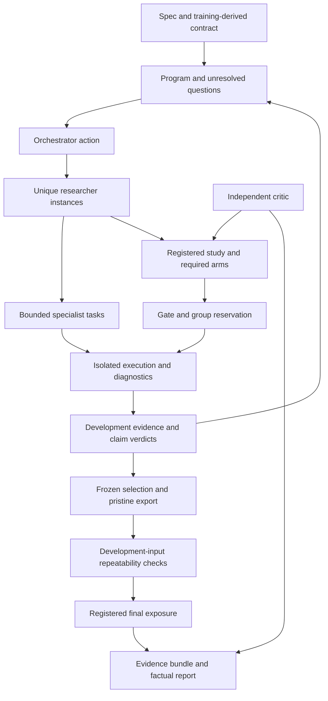

# V3 architecture and preservation record

Implemented 2026-11-12. This describes the current software, not an experimental demonstration of autonomous discovery. See [the migration plan](V3_MIGRATION_PLAN.md), [progress and limitations](V3_PROGRESS.md), [independent validation](V3_TEST_RESULTS.md), and [usage](V3_USAGE.md).

## Runtime and ownership

`pipeline: v3` selects `ResearchSchedulerV3`, a subclass of V2's scheduler. It reuses V2 data/problem preparation, method normalization, implementation gate, job construction, isolated execution, result storage, ranking and ensemble utilities. Its scientific control loop and finalization are V3-specific. V1 and V2 retain their entry paths.

An injected `decision_fn` or configured orchestrator model selects structured actions from a safe development view. The offline fallback decomposes questions, creates researchers, executes registered studies and uses measured outcomes to choose follow-up analysis or stopping. Full study results enter the program before the next action. Actions, refusals and results are persisted; an LLM cannot assign a certified scientific verdict directly.

Agent IDs are distinct from personas. `DelegationManager` enforces total/active agent, depth, children, task and turn limits. Researchers can request coding/execution, analysis, retrieval and source specialists; nested callbacks return artifacts, errors and uncertainty to the parent. `RoleRouter` supports inherited or distinct orchestrator/researcher/critic/specialist configurations and explicit escalation, with recorded backend/model, call attribution, costs and fallback reasons. Provider-reported unknown costs remain unknown.

The critic reviews study design/evidence and program synthesis. Blocking objections remain durable and can downgrade supported claims. Resolution needs related evidence or a related revision; acknowledged uncertainty remains visible and does not fulfill an absent measurement. The critic cannot be replaced by a researcher identity.

## Scientific and execution contracts

| Module | Responsibility |
| --- | --- |
| `research/contracts_v3.py` | Measured problem dimensions, exact metric/noise/privilege contract; requested/effective method identities; conservative per-claim evidence checks. |
| `research/studies_v3.py` | Stable study/arm/claim IDs, dependency validation, required-work completion, matching checks and paired bootstrap analysis. |
| `research/program_v3.py` | Provider-neutral role routing and bounded actual specialist dispatch. |
| `scheduler_v3.py` | Action loop, researcher ownership, critic consequences, group scheduling, evidence feedback, diagnostic adapters, finalization and resume. |
| `runner.py`, `executor.py`, `resources.py`, `export.py` | Process isolation, protocol-aware caching, runtime provenance, reservations and pristine export certification. V3 behavior is selected explicitly. |
| `knowledge_v3.py` | Safe typed evidence routing, verified durable packages, frozen knowledge snapshots, persistent exposure accounting, protocol validation and descriptive program metrics. |
| `agents/reporter_v3.py` | Deterministic report/model card and program metrics derived from the persisted evidence bundle. |

A claim distinguishes performance, comparison, mechanism and mathematical evidence. A scalar threshold cannot establish a mechanism or proof. Comparisons use explicit controls and registered varying factors. Relative improvement is signed in the metric's improvement direction: “at least 30% worse” requires an effect at or below -0.30. Nonfinite values, missing controls, unmatched rows/configurations, missing verification and missing required uncertainty do not support a claim. Paired intervals must identify the actual metric, arms and evaluation protocol.

Study completion is separate from hypothesis success and final model accuracy. Required arms, dependencies, diagnostics and implicit claim evidence obligations remain attached to the study. Missing evidence produces incomplete work; a measured negative result or an interval overlapping a decision boundary can complete a study with contradicted or inconclusive claims. Reports retain both states.

Required execution groups are admitted together. Dependency waves preserve prerequisite ordering, including deduplicated aliases. Identical executions can serve several arms with retained evidence bindings; reusing an arm ID cannot change its scientific/execution identity. Random-search arms expand into bounded candidate groups, retain the parent policy and selected candidate, and require separate confirmation before a search-selected result supports a confirmatory claim. A real immutable prediction-sharing adapter reuses computation; generic shared fitted-state and solver-trajectory protocols remain unsupported and explicit.

The runner records actual row identities, effective methods/source hashes, seed/fidelity and fit/predict verification. The existing deterministic gate and custom-code sandbox remain separate from scientific criticism. Development jobs receive training and validation evidence, not final/shift arrays. V3 dataset cache identity includes the exact split sizes, avoiding collisions between different allocations of the same total sample count; V1/V2 cache identity is retained.

## Knowledge and held-out boundaries

The evidence router addresses explicit local contract/source metadata, allowlisted artifacts, diagnostics, memory, theorem retrieval, optional empirical literature and method packages. It does not provide arbitrary filesystem reads. Final/report artifacts are denied through this router, and nested held-out fields and unsafe narrative are conservatively withheld. Unknown theorem applicability remains a lead. These are supplied-context controls, not a proven whole-machine confidentiality boundary: backend CLI permissions and the existing code sandbox retain their own limits, and live backend isolation was not tested.

`MethodPackageStore` keeps inline source/configuration, content hashes, interface, provenance, applicability, validation and failure conditions outside temporary run directories. Loading verifies the package and reapplies the gate; static approval is not runtime verification or successful transfer. Packages can be retrieved as evidence or used by a package-backed study arm. Frozen memory persists a safe hashed snapshot across resume; cumulative memory explicitly permits new records.

The SQLite exposure registry is independent of research memory. An atomic reservation precedes attempted access; `begin` consumes the token once, and success completes it. Strict mode rejects prior exposure to the same held-out split. Interrupted attempted access without recoverable results remains uncertain. Resume rejects changed compiled specifications. Completed-run resume returns saved output; final-result recovery reuses persisted evidence instead of evaluating again, restoring experiment counters to avoid overwriting prior work. Registry sharing is local to the configured SQLite path; separate copies are not a distributed global registry.

Final selection is frozen from development evidence. The runner fits and serializes pristine state before inference, then checks repeat, reload and partition behavior on development inputs. Only a certified export proceeds to final evaluation. The artifact used for final predictions is the exported model itself. Manifest, model card, report and evidence bundle carry the certificate. This is protocol-specific repeatability evidence, not a guarantee about every future input or a proof of an algorithmic property.

## Artifact authority, costs and limits

`artifacts.jsonl` is the append-only execution/provenance history. Program snapshots restore actions, agents, tasks, frozen knowledge and evidence bindings. `evidence_bundle.json` captures final scientific facts, including failures and missing evidence; the reporter rebuilds from this bundle. `research_trace_v3.json`, `program_evaluation.json`, final manifest/model card and status files are user-facing projections.

Reservations protect confirmation/export capacity from optional work. Soft mode admits estimated costs; hard mode reserves process timeout bounds. Actual subprocess time, overruns, role calls and attribution are recorded. Startup/termination overhead may exceed timeout bounds. Data setup and in-process preliminary diagnostics contribute to elapsed wall time and are not a universal hard worker-time guarantee.

Specialist callbacks have observed soft deadlines, while underlying execution/retrieval adapters have their own timeouts. Arbitrary in-process callbacks cannot be forcibly preempted. Other explicit limits are generic shared fit/trajectory adapters, formal proof verification, unconfigured empirical-literature providers and empirical discovery/transfer validation. Evaluation metrics leave unmeasured discovery/transfer unknown rather than treating package availability, citation volume or a strong baseline as scientific success.

## V2 preservation and changed behavior

| V2 capability | V3 treatment |
| --- | --- |
| Library, physics, hybrid, custom ML/solver and random search | Existing factories/gates/runner retained; bounded search expanded into explicit candidate obligations. Forward access remains configurable. |
| Custom-method freedom and code artifacts | Retained through researcher/specialist structured methods, static/runtime validation and durable package provenance. |
| Fixed persona team and pre-execution debate | Replaced by unique dynamic instances, scoped questions, real specialist callbacks and full-result feedback between actions. |
| Proposal-level scalar support and moving family references | Replaced by typed per-claim verdicts and fixed comparator/evidence identities. Historical outcomes are not rewritten. |
| Individual-method portfolio selection | Replaced for V3 scientific work by required study groups, dependencies and explicit deferral/completion. |
| Critic prose | Retained as an independent role, with persistent consequential objections. |
| Automatic local refinement | Available in V2; V3 expresses scientific revisions as explicit studies/actions so changes retain evidence obligations. |
| Ensemble/model evaluation, uncertainty and final artifacts | Reused, with V3 pristine export certification and separate model/scientific outcomes. |
| Literature, memory, artifact ledger and resume | Retained and extended with typed routing, safe projections, runnable packages, frozen snapshots and independent exposure accounting. |

No historical reports or ablation outcomes were regenerated. Validation uses small software fixtures, not a new research campaign. The [independent validation record](V3_TEST_RESULTS.md) states which behaviors were actually tested and which remain limits.
